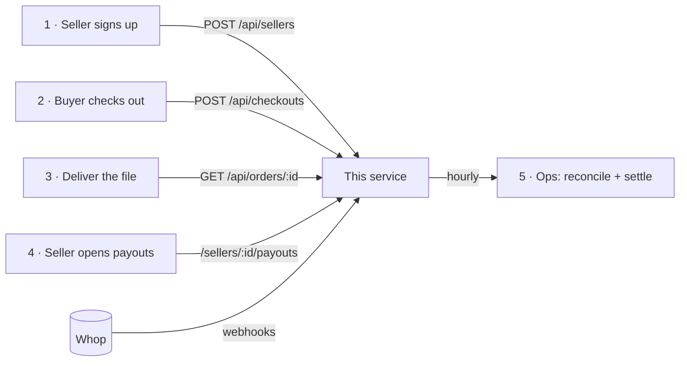

# Ledgerly × Whop: handover

Start here. This is what we built, how it plugs into Ledgerly, how to run it, and what's still yours to decide.

## What this is

A small service that runs **Ledgerly's payments on Whop**. It replaces the old setup (Ledgerly's own processor, holding sellers' money, wiring them monthly) and nothing else.

| This service does | Ledgerly keeps doing |
| --- | --- |
| Sign sellers up on Whop and verify them (KYC) | Seller accounts, profiles, login |
| Create checkouts with Ledgerly's 8% fee | Catalog, storefront, search, carts |
| Pay sellers: directly at checkout, or by transfer for sellers who may not take payments | Delivering the digital files |
| Seller payouts page: balance, withdraw, activity | Buyer accounts and support |
| Record every money event exactly once in its own ledger | |
| Check Ledgerly's books against Whop every hour | |

It is a Next.js app (API + a few pages) with a Postgres database. It runs today at <https://ledgerly-whop.vercel.app> on Vercel and Supabase.

## The five places it touches Ledgerly



All API calls send `Authorization: Bearer $ADMIN_API_TOKEN`. Full request and response shapes are in the [README](README.md#http-api).

1. **When a seller signs up** (or for every existing seller, during migration): `POST /api/sellers` with `{ externalId, email, country, title, collectionMode }`. Use Ledgerly's own seller id as `externalId`. Send the seller to the returned `onboardingUrl` to verify their identity. Calling it again for the same seller is safe: it returns the same Whop account and a fresh link.
2. **When a buyer checks out**: `POST /api/checkouts` with `{ sellerExternalId, title, sku, price, requestKey }`, then redirect the buyer to `purchaseUrl`. Use Ledgerly's cart or order id as `requestKey`, so a retried request returns the same checkout instead of a second one. The 8% fee and the payment flow are decided here, from the seller's `collectionMode`. USD only for now.
3. **Before delivering the file**: `GET /api/orders/:orderId` and deliver when `deliverable` is `true`. Buyers come back to `/orders/:orderId` after paying; point that at your own thank-you page if you prefer (`redirect_url` in [`src/lib/checkout.ts`](src/lib/checkout.ts)).
4. **Seller payouts page**: link signed-in sellers to `/sellers/:externalId/payouts`. **Replace the demo sign-in**: [`src/lib/seller-session.ts`](src/lib/seller-session.ts) implements `currentSeller()` and `isOperator()` with expiring demo links. Swap both for checks against Ledgerly's own session (verify Ledgerly's session cookie or JWT and return the seller's external id, or whether the user is staff), then set `DEMO_LOGIN_ENABLED=false`. Nothing else changes.
5. **Operations** run by themselves every hour (`/api/cron/ops`) and alert on problems. Engineers use the `pnpm ledgerly` CLI for everything else. See the [runbook](RUNBOOK.md).

## Deploy your own copy (about 15 minutes)

1. **Whop**: in Ledgerly's Whop dashboard → Developer → **Create API key** with the custom permissions listed in the [README](README.md#api-key-scopes) (needs 2FA).
2. **Database**: create a Supabase project, then `supabase link --project-ref <ref>` and `supabase db push`.
3. **Config**: `cp .env.example .env.local` and fill it in. Generate `ADMIN_API_TOKEN`, `CRON_SECRET` and `SESSION_SECRET` with `openssl rand -hex 32`. Set `ALERT_WEBHOOK_URL` to a Slack incoming webhook to get alerts.
4. **Host**: `vercel link`, add every variable from `.env.local` with `vercel env add`, then `vercel deploy --prod`. Set `APP_URL` to the deployed https URL.
5. **Webhook**: `pnpm ledgerly webhook:create`. It registers one webhook for Ledgerly and all sellers (the eight core events plus `refund.updated`, `dispute.updated`, `transfer.failed`) and writes the signing secret to `.env.local`. Add `WHOP_WEBHOOK_SECRET` and `WHOP_WEBHOOK_ID` to the host and redeploy.
6. **Check**: `pnpm ledgerly smoke` (live checks that move no money) and `pnpm ledgerly reconcile` (every seller `ok: true`).

## Migrating the 3,000 existing sellers

```bash
pnpm ledgerly import-sellers sellers.csv --dry-run      # validate everything, create nothing
pnpm ledgerly import-sellers sellers.csv                # create accounts + onboarding links
```

- CSV columns: `external_id, email, country, title, collection_mode` ([example](examples/migration/sellers.sample.csv)). Country is a 2-letter code. `collection_mode` is `direct` (default) or `platform`.
- Every row is validated before anything is created. Bad rows are listed with the reason.
- It is **safe to re-run**. An interrupted import resumes by running the same file again: sellers that already have a Whop account are reused (with a fresh onboarding link), never duplicated. A row whose email, country or policy conflicts with what's already stored is reported as an error, not silently changed.
- Invalid rows are reported and skipped; valid rows in the same file are still imported. Use `--dry-run` first to see both.
- It writes `sellers.results.csv` with each seller's Whop account id and onboarding link. Email the links to sellers. Links expire after about an hour, so for sellers who open them later, generate a fresh one with `pnpm ledgerly onboarding-link <id>` or by calling `POST /api/sellers` again.
- Suggested rollout: 50 sellers, check the results and the next hourly ops run, then batches of 500.

## Who owns what after handover

| Thing | Owner | Where |
| --- | --- | --- |
| Whop platform account, API keys, webhook | Ledgerly | Whop dashboard → Developer |
| Code | Ledgerly engineering | This repo. CI runs typecheck, lint, unit tests, Postgres integration tests and the build on pushes to `main` and on pull requests |
| Hosting, cron, env vars | Ledgerly engineering | Vercel project |
| Database and backups | Ledgerly engineering | Supabase project |
| Alerts | Ledgerly on-call | `ALERT_WEBHOOK_URL` (any Slack-compatible incoming webhook) |
| Seller KYC, payouts, disputes | Whop, with Ledgerly as platform | Whop dashboard → Sub accounts |

## Decisions for Ledgerly before full launch

These came out of running real money through Whop. Items 1–6 need a business decision; 7 and the code items in the checklist below are engineering work.

1. **What sellers receive (USD vs USDT).** In the test run Ledgerly's balance was topped up with a USDT crypto deposit (it lands in seconds; a bank deposit takes 1–3 business days). Transfers requested in `usd` were then paid out of that USDT, so sellers received USDT, while the API still reported `usd`. Decide which asset sellers should be paid in, fund Ledgerly's balance accordingly (bank deposit for USD), and confirm with Whop how transfers choose between USD and USDT when both are available.
2. **Refunds before settlement.** A seller can't refund a sale until its funds settle (about 1–2 days), and Whop's fees aren't returned. Today Ledgerly fronts the refund with a transfer. Decide whether to keep that, and how to recover advances from sellers' later sales (not automated yet).
3. **Who pays processing fees.** Direct sellers pay Whop's fees. Platform-collected sellers are paid under the same policy (Whop's processing fees and the 8% come off their share). Ledgerly absorbs the sales-tax service fee on its own sales.
4. **Sales tax.** When Ledgerly is the merchant (platform-collected sales), Whop adds and remits sales tax. On direct charges to individual sellers it didn't. Confirm the tax position with Whop and your advisor.
5. **8% as a checkout fee vs an account markup.** Today each checkout sets `application_fee_amount`. Whop can instead apply an 8% payment markup to every connected account automatically, which removes a per-checkout step.
6. **Instant payouts.** Ledgerly charges +$0.50 on instant withdrawals, but Whop hasn't enabled instant payouts on the test seller yet. Ask Whop how sellers qualify.
7. **Currencies.** Checkouts are USD-only today. Supporting EUR and BRL sellers means settling and reconciling per currency (the reconciliation already compares balances per currency) and running a small real sale in each before onboarding those sellers.
8. **Sellers who must never take payments directly.** This service never gives them a direct checkout, but their Whop accounts can still accept card payments (Whop's API has no way to turn that off). If that must be guaranteed platform-wide, ask Whop to restrict those accounts.

## Go-live checklist

- [ ] Replace the demo sign-in with Ledgerly's auth (`currentSeller()`, `isOperator()`), then set `DEMO_LOGIN_ENABLED=false`.
- [ ] Decide who gets operator access (the console at `/` and seller status pages show seller and order details).
- [ ] Define retention for the webhook inbox (`webhook_events`): it stores raw payloads, which include buyers' names and card digits.
- [ ] Set `ALERT_WEBHOOK_URL` and confirm an alert arrives (break a test seller's ledger, run `/api/cron/ops`).
- [ ] Rotate every secret created during the build (see the runbook) and keep keys out of chat and tickets.
- [ ] Decide items 1–4 above.
- [ ] Migrate sellers in batches, watching the hourly ops run.
