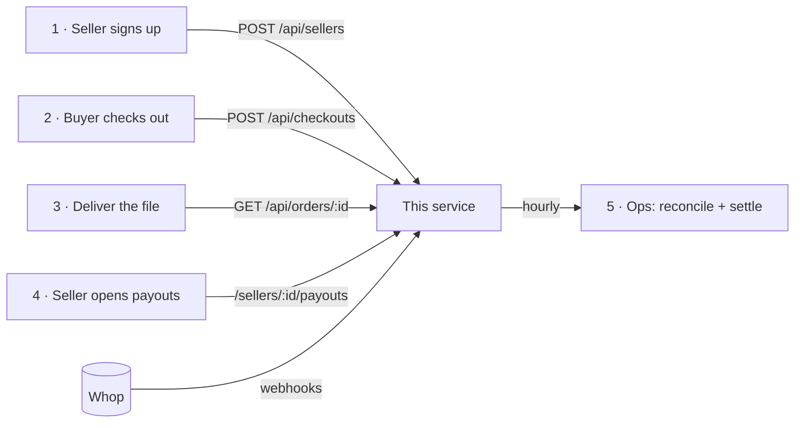

# Ledgerly × Whop: handover

Start here. This is what we built, how it plugs into Ledgerly, how to run it, and what's still yours to decide.

## What this is

A small service that runs **Ledgerly's payments on Whop**. It replaces the old setup (Ledgerly's own processor, holding sellers' money, wiring them monthly) and nothing else.

| This service does | Ledgerly keeps doing |
| --- | --- |
| Sign sellers up on Whop and verify them (KYC) | Seller accounts, profiles, login |
| Create checkouts with Ledgerly's 8% fee | Catalog, storefront, search, carts |
| Pay sellers: directly at checkout, or by transfer for sellers who may not take payments | Delivering the digital files |
| Seller payouts page: balance, withdraw, activity | Buyer accounts and support |
| Keep its own ledger of payments, refunds, transfers and payouts, each applied once however often Whop sends it ([what's guaranteed](README.md#what-is-and-isnt-guaranteed)) | |
| Check Ledgerly's books against Whop every hour | |
| Operator console for staff: who still needs verification, reminders, payment mode and fee per seller | |

It is a Next.js app (API + a few pages) with a Postgres database. It runs today at <https://ledgerly-whop.vercel.app> on Vercel and Supabase.

It also has a **demo marketplace** that stands in for the right-hand column, so the whole flow can be shown with real money: `/shop` (buy, pay on Whop, download the file) and `/sell` (sign up, open a store, verify with Whop, list products). In production Ledgerly's own site replaces it and calls the API below. See [README: Demo marketplace](README.md#demo-marketplace).

## The five places it touches Ledgerly



All API calls send `Authorization: Bearer $ADMIN_API_TOKEN`. Full request and response shapes are in the [README](README.md#http-api).

1. **When a seller signs up** (or for every existing seller, during migration): `POST /api/sellers` with `{ externalId, email, country, title, collectionMode }`. Use Ledgerly's own seller id as `externalId`. Redirect the seller straight to the returned `onboardingUrl` (Whop's identity check; it expires in about an hour). Whop doesn't email it, and neither do we. If they leave, their status page `/sellers/:externalId` has a **Continue verification** button that mints a fresh link. Calling the API again for the same seller is safe: same Whop account, fresh link.
   - **Capacity:** each signup is two Whop calls, and Whop allows about 600 calls a minute per operation, so roughly 600 new sellers a minute. Bursts beyond that get `502` with Whop's `429`; retry with backoff (it's idempotent). For a launch-day spike, record the seller and let the Continue verification button create the link when they're ready.
2. **When a buyer checks out**: `POST /api/checkouts` with `{ sellerExternalId, title, sku, price, requestKey }`, then redirect the buyer to `purchaseUrl`. Use Ledgerly's cart or order id as `requestKey`, so a retried request returns the same checkout instead of a second one. The fee and the payment flow are decided here, from the seller's settings: 8% unless staff set another rate for that seller, and `collectionMode` (both changeable in the console, for new purchases). USD only for now.
3. **Before delivering the file**: `GET /api/orders/:orderId` and deliver when `deliverable` is `true`. Buyers come back to `/orders/:orderId` after paying; point that at your own thank-you page if you prefer (`redirect_url` in [`src/lib/checkout.ts`](src/lib/checkout.ts)).
4. **Seller payouts page**: link signed-in sellers to `/sellers/:externalId/payouts`. **Replace the seller sign-in**: `currentSeller()` in [`src/lib/seller-session.ts`](src/lib/seller-session.ts) returns the seller from a demo link session or the demo marketplace's Supabase session. Swap it for a check against Ledgerly's own session (verify Ledgerly's session cookie or JWT and return the seller's external id), then set `DEMO_LOGIN_ENABLED=false`. Nothing else changes.
   - **Staff already sign in for real**: the console at `/` has **Sign in with Whop**. Anyone on Ledgerly's Whop team as owner, admin, manager or support gets in; add or remove people in Whop (Settings → Team). It uses the Whop OAuth app "Ledgerly Console" and needs `company:authorized_user:read` on the API key. The console leans on Whop's dashboard (Sub accounts) for browsing sellers, payments and refunds, and links to it for each seller.
5. **Operations** run by themselves every hour (`/api/cron/ops`) and alert on problems. Engineers use the `pnpm ledgerly` CLI for everything else. See the [runbook](RUNBOOK.md).

## Deploy your own copy

Steps 3 and 5 are only for the demo marketplace; skip them once Ledgerly's own site is wired in.

1. **Whop API key**: in Ledgerly's Whop dashboard → Developer → **Create API key** with the custom permissions listed in the [README](README.md#api-key-scopes) (needs 2FA).
2. **Staff sign-in**: create a Whop app "Ledgerly Console" (dashboard → Developer, or `whop apps create`) with redirect URI `$APP_URL/api/auth/whop/callback`. On its Permissions tab add `oauth:token_exchange`; on its OAuth tab choose Confidential and copy the client secret (the CLI doesn't return it). These are `WHOP_OAUTH_CLIENT_ID` and `WHOP_OAUTH_CLIENT_SECRET`.
3. **Seller "Continue with Whop"**: a second Whop app, "Ledgerly", set up the same way with redirect URI `$APP_URL/auth/whop/callback`. These are `WHOP_SELLER_APP_ID` and `WHOP_SELLER_APP_KEY`.
4. **Database**: create a Supabase project, then `supabase link --project-ref <ref>` and `supabase db push`.
5. **Supabase Auth and Storage**:
   - Auth → URL Configuration: add `$APP_URL/auth/callback` to the redirect URLs.
   - Auth → Providers: Email with "Confirm email" on. Supabase's built-in email is rate-limited, so set up custom SMTP before real sellers sign up.
   - Auth → Providers → Google: create an OAuth client in Google Cloud (web application, authorized redirect URI `https://<ref>.supabase.co/auth/v1/callback`) and paste its id and secret.
   - Storage: a **private** bucket `deliverables` with a 10 MB file size limit.
   - Keys: `NEXT_PUBLIC_SUPABASE_URL`, `NEXT_PUBLIC_SUPABASE_PUBLISHABLE_KEY`, and the **legacy** `service_role` JWT as `SUPABASE_SERVICE_ROLE_KEY` (Storage's REST API rejects the new `sb_secret_` keys).
6. **Config**: `cp .env.example .env.local` and fill it in. Generate `ADMIN_API_TOKEN`, `CRON_SECRET` and `SESSION_SECRET` with `openssl rand -hex 32`. Set `ALERT_WEBHOOK_URL` to a Slack incoming webhook to get alerts.
7. **Host**: `vercel link`, add every variable from `.env.local` with `vercel env add`, then `vercel deploy --prod`. Set `APP_URL` to the deployed https URL.
8. **Webhook**: `pnpm ledgerly webhook:create`. It registers one webhook for Ledgerly and all sellers (the eight core events plus `refund.updated`, `dispute.updated`, `transfer.failed`) and writes the signing secret to `.env.local`. Add `WHOP_WEBHOOK_SECRET` and `WHOP_WEBHOOK_ID` to the host and redeploy.
9. **Check**: `pnpm ledgerly smoke` (live checks that move no money) and `pnpm ledgerly reconcile` (every seller `ok: true`).

## Migrating the 3,000 existing sellers

```bash
pnpm ledgerly import-sellers sellers.csv --dry-run      # validate everything, create nothing
pnpm ledgerly import-sellers sellers.csv                # create accounts + onboarding links
```

- CSV columns: `external_id, email, country, title, collection_mode` ([example](examples/migration/sellers.sample.csv)). Country is a 2-letter code. `collection_mode` is `direct` (default) or `platform`.
- Every row is validated before anything is created. Bad rows are listed with the reason.
- It is **safe to re-run**. An interrupted import resumes by running the same file again: sellers that already have a Whop account are reused (with a fresh onboarding link), never duplicated. A row whose email, country or policy conflicts with what's already stored is reported as an error, not silently changed. The title is only used when the account is created; change it in Whop afterwards.
- One gap: if the service crashes after Whop creates an account but before saving its id, a re-run **within 24 hours** gets the same account back (Whop's idempotency key). After 24 hours it would create a second one. For a seller whose earlier attempt errored, check Whop first (Sub accounts, search the email; each account carries `metadata.external_id`).
- Invalid rows are reported and skipped; valid rows in the same file are still imported. Use `--dry-run` first to see both.
- It writes `sellers.results.csv` with each seller's Whop account id and onboarding link. Whop's links expire after about an hour, so **email sellers a link to their Ledgerly status page** (`/sellers/<id>`, behind Ledgerly's login) instead; its **Continue verification** button mints a fresh Whop link every time. The importer runs 3 at a time and retries Whop's rate limit (about 600 calls a minute), so 3,000 sellers take roughly 10–20 minutes.
- After each batch run `pnpm ledgerly sellers:sync` so the console's "needs verification" list covers the new sellers (the hourly job refreshes at most 100 sellers a run; webhooks keep them current after that).
- Suggested rollout: 50 sellers, check the results and the next hourly ops run, then batches of 500.

## Who owns what after handover

| Thing | Owner | Where |
| --- | --- | --- |
| Whop platform account, API keys, webhook, OAuth apps | Ledgerly | Whop dashboard → Developer |
| Staff access to the console | Ledgerly admins | Whop dashboard → Settings → Team |
| Code | Ledgerly engineering | This repo. CI runs typecheck, lint, unit tests, Postgres integration tests and the build on pushes to `main` and on pull requests |
| Hosting, cron, env vars | Ledgerly engineering | Vercel project |
| Database and backups (and, for the demo marketplace, seller auth and product files) | Ledgerly engineering | Supabase project |
| Alerts | Ledgerly on-call | `ALERT_WEBHOOK_URL` (any Slack-compatible incoming webhook) |
| Seller KYC, payouts, disputes | Whop, with Ledgerly as platform | Whop dashboard → Sub accounts |

## Decisions for Ledgerly before full launch

These came out of running real money through Whop. Most need a business decision; 8 (currencies) and the code items in the checklist below are engineering work.

1. **What sellers receive (USD vs USDT).** In the test run Ledgerly's balance was topped up with a USDT crypto deposit (it lands in seconds; a bank deposit takes 1–3 business days). Transfers requested in `usd` were then paid out of that USDT, so sellers received USDT, while the API still reported `usd`. Decide which asset sellers should be paid in, fund Ledgerly's balance accordingly (bank deposit for USD), and confirm with Whop how transfers choose between USD and USDT when both are available.
2. **Refunds before settlement.** A seller can't refund a sale until its funds settle (about 1–2 days), and Whop's fees aren't returned. Today Ledgerly fronts the refund with a transfer. Decide whether to keep that, and how to recover advances from sellers' later sales (not automated yet).
3. **Who pays processing fees.** Direct sellers pay Whop's fees. Platform-collected sellers are paid under the same policy (Whop's processing fees and the 8% come off their share). Ledgerly absorbs the sales-tax service fee on its own sales.
4. **Sales tax.** When Ledgerly is the merchant (platform-collected sales), Whop adds and remits sales tax. On direct charges to individual sellers it didn't. Confirm the tax position with Whop and your advisor.
5. **Instant payouts.** Ledgerly charges +$0.50 on instant withdrawals, but Whop hasn't enabled instant payouts on the test seller yet. Ask Whop how sellers qualify.
6. **When platform-collected sellers get paid.** Today their share is transferred into their Whop balance seconds after the buyer pays, and they withdraw to their bank whenever they choose (the hourly job only catches up on anything missed). That's fast for sellers, but a refund or chargeback after that is Ledgerly's to recover. The alternative is escrow: hold the share until the refund window passes (say 7–14 days). That's a small change: stop settling right after payment and have the hourly job settle only orders older than the window.
7. **Automatic payouts to sellers' banks.** Sellers withdraw themselves today. Whop also has automatic withdrawals, and they work on connected accounts: in the seller's Whop dashboard, Balances → USD → ⋯ → **Set up auto-withdrawals** (minimum balance to keep, daily or other frequency, payout method; $2.50 per standard bank payout). There is no API for it, so each seller turns it on themselves; Ledgerly can't do it in code. Decide whether to tell sellers about it, or ask Whop for a platform-level default.
8. **Currencies.** Checkouts are USD-only today. Supporting EUR and BRL sellers means settling and reconciling per currency (the reconciliation already compares balances per currency) and running a small real sale in each before onboarding those sellers.
9. **Sellers who must never take payments directly.** This service never gives them a direct checkout, but their Whop accounts can still accept card payments (Whop's API has no way to turn that off). If that must be guaranteed platform-wide, ask Whop to restrict those accounts.

## Go-live checklist

- [ ] Replace the demo marketplace with Ledgerly's own site: its checkout calls `POST /api/checkouts`, its delivery checks `GET /api/orders/:id`, and `currentSeller()` checks Ledgerly's session. Then set `DEMO_LOGIN_ENABLED=false`, take `/shop` and `/sell` down, and drop `WHOP_SELLER_APP_*` and the Supabase Auth keys.
- [ ] Review who is on Ledgerly's Whop team: they can sign in to the console.
- [ ] Decide who gets operator access (the console at `/` and seller status pages show seller and order details, and staff can change a seller's payment mode and fee).
- [ ] Define retention for the webhook inbox (`webhook_events`): it stores raw payloads, which include buyers' names and card digits.
- [ ] Set `ALERT_WEBHOOK_URL` and confirm an alert arrives (break a test seller's ledger, run `/api/cron/ops`).
- [ ] Rotate every secret created during the build (see the runbook) and keep keys out of chat and tickets.
- [ ] Decide items 1–4 and 6 above.
- [ ] Before volume grows, give the hourly reconciliation a time window: it reads Ledgerly's full payment history on every run.
- [ ] Migrate sellers in batches, watching the hourly ops run.
