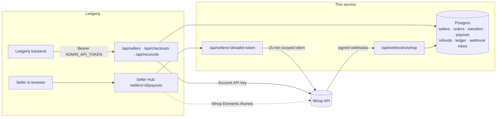
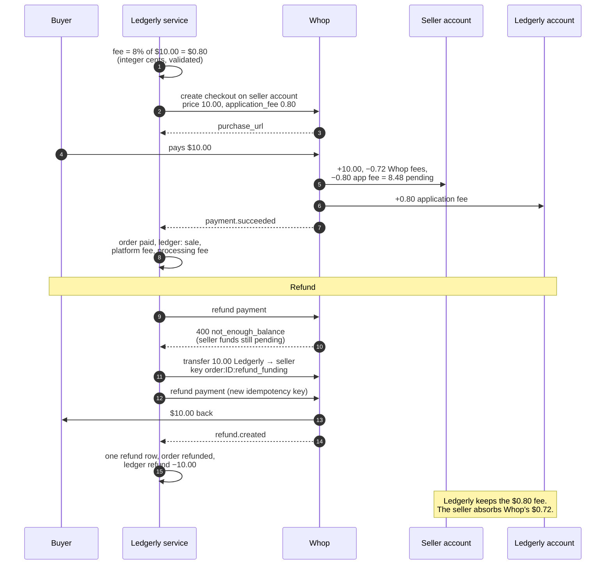
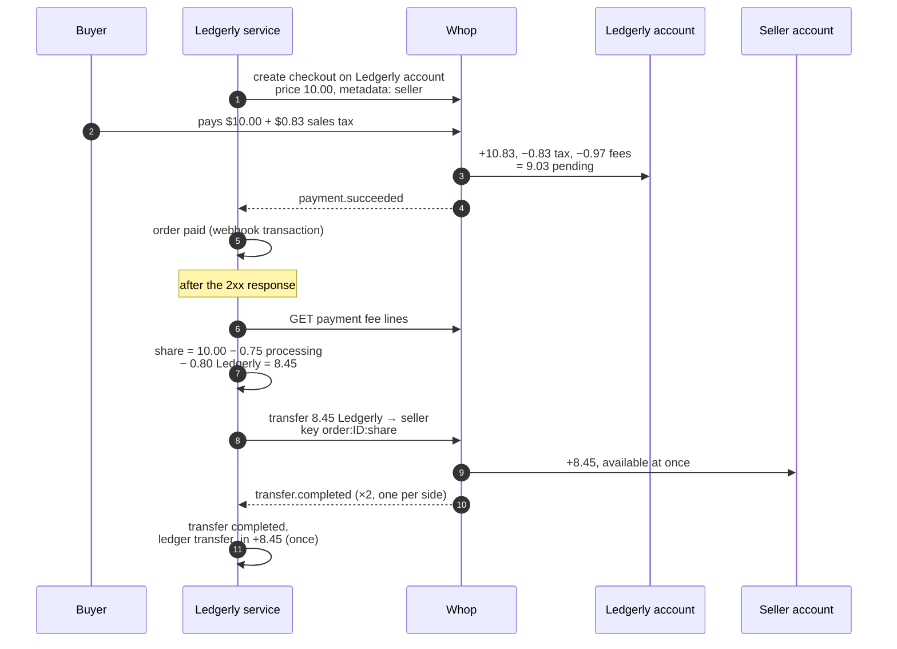

# Ledgerly on Whop

Ledgerly is a marketplace for creators' digital goods: 3,000 sellers in 40 countries. This repo moves it off its own processor and monthly wire payouts onto **Whop Platforms**:

- every seller is a Whop **connected account** under Ledgerly's platform account
- buyers pay through Whop, and Ledgerly keeps **8% of every sale**
- sellers see their balance and **withdraw on their own**, inside Ledgerly's site
- some sellers are never allowed to take payments directly; Ledgerly collects and pays them by **transfer**
- webhooks are processed **exactly once**, across retries, replays and restarts
- a **reconciliation job** proves Ledgerly's books match Whop's

It runs in production at <https://ledgerly-whop.vercel.app> (Next.js on Vercel, Postgres on Supabase). Everything here was exercised with real money; the proof run and raw API responses are in [`examples/assessment/`](examples/assessment) with personal data removed.

> **Ledgerly team: start with [HANDOVER.md](HANDOVER.md)** (what this is, how it plugs into Ledgerly, deploy, migrate sellers, open decisions) and keep [RUNBOOK.md](RUNBOOK.md) for on-call. This README is the technical reference.

---

## Contents

1. [Architecture](#architecture)
2. [Money flows](#money-flows)
3. [Exactly-once webhooks](#exactly-once-webhooks)
4. [Reconciliation](#reconciliation)
5. [Seller payouts UI](#seller-payouts-ui)
6. [HTTP API](#http-api)
7. [Setup](#setup)
8. [Operating it](#operating-it)
9. [Decisions and trade-offs](#decisions-and-trade-offs)
10. [Whop behaviour to know before going live](#whop-behaviour-to-know-before-going-live)
11. [Assessment proof run](#assessment-proof-run)

---

## Architecture



| Path | What lives there |
| --- | --- |
| [`src/lib/onboarding.ts`](src/lib/onboarding.ts) | Idempotent create-or-fetch of a seller's connected account + onboarding link |
| [`src/lib/checkout.ts`](src/lib/checkout.ts) | 8% fee math, direct-charge and platform-collected checkouts, seller share + settlement |
| [`src/lib/transfers.ts`](src/lib/transfers.ts) | Keyed, replay-safe transfers to sellers |
| [`src/app/api/webhooks/whop/route.ts`](src/app/api/webhooks/whop/route.ts) | Webhook consumer: signature check, inbox, transaction |
| [`src/lib/webhook-handlers.ts`](src/lib/webhook-handlers.ts) | Per-event business effects (orders, refunds, transfers, payouts, accounts) |
| [`src/lib/reconcile.ts`](src/lib/reconcile.ts) | Two-way diff of Whop vs the local ledger |
| [`src/lib/wallet.ts`](src/lib/wallet.ts) | Short-lived, explicitly scoped tokens for the embedded payouts UI |
| [`supabase/migrations`](supabase/migrations) | Schema |
| [`cli/ledgerly.ts`](cli/ledgerly.ts) | The `pnpm ledgerly` operations CLI |
| [`src/lib/import-sellers.ts`](src/lib/import-sellers.ts) | Bulk seller migration from CSV |
| [`src/lib/ops-job.ts`](src/lib/ops-job.ts) | Hourly job: payout sync, reconcile, settle, alert |
| [`examples/assessment/`](examples/assessment) | The assessment's proof run: one script per step, plus evidence |
| [`tests/`](tests) | Fee math, seller share on real fee data, signatures, envelope versions, reconciliation |

---

## Money flows

Two ways money reaches a seller. Which one is used is a per-seller policy (`sellers.collection_mode`); `POST /api/checkouts` picks it, so a `platform` seller can never be given a direct checkout.

### 1. Direct charge (`collection_mode = direct`)

The buyer pays the **seller's** connected account. Whop takes Ledgerly's 8% off as an application fee and settles it to Ledgerly. The seller is the merchant: they pay Whop's processing fees and own refunds and disputes.



### 2. Platform-collected sale + transfer (`collection_mode = platform`)

The buyer pays **Ledgerly's** account; Ledgerly is the merchant of record (Whop adds and remits sales tax). As soon as the payment webhook arrives, Ledgerly transfers the seller's share. The share is set at **parity with a direct charge**: gross − Whop's processing fees − 8%. Sales tax is excluded (the buyer paid it on top) and Ledgerly absorbs the tax-service fee.



`settlePlatformOrder` always pays **what is owed minus what was already sent**, keyed on the target amount. A missed or failed settlement is retried by the hourly ops job or `pnpm ledgerly settle`; a corrected formula produces exactly one adjustment transfer (`order:<id>:share:to-845`).

---

## Exactly-once webhooks

Whop delivers **at least once**, retries for ~3 days, doesn't guarantee order, and in practice sends near-duplicates: three identical `payout.updated` bodies with different ids for one payout, and two `transfer.completed` per transfer (one per participant). The consumer is built for that:

1. **Verify** the Standard Webhooks signature on the raw body (`unwrapWebhook` from `@whop/sdk/helpers`, `ws_…` secret used verbatim, 5-minute timestamp tolerance).
2. **Inbox**: `insert into webhook_events … on conflict (webhook_id) do nothing`, then `select … for update`. Concurrent deliveries of one message serialize on the row lock; an already-processed message returns `200 duplicate`.
3. **One transaction**: the handler's ledger writes and `processed_at` commit together. A crash rolls both back and Whop's retry does the work exactly once. A throw returns 5xx so Whop retries.
4. **Business keys, not message ids**: every effect is keyed on the Whop object (`payment:<id>:sale`, `transfer:<id>`, `payout:<id>`, refund id). A replay with a regenerated id, or a second delivery for the other transfer participant, is a no-op.
5. **Forward-only state**: payout rows only move forward in event time; orders only go `pending|failed → paid`, so a late `payment.succeeded` can't undo a refund.
6. **Version-tolerant routing**: `account_id` (payloads pinned to `2026-08-14`+), else `company_id` (older/unpinned), else the object's own account. Legacy `withdrawal.*` events use the same handler as `payout.*` (same `wdrl_` id), so they can't double-post.
7. Work that calls Whop (the seller transfer) runs **after** the 2xx via `after()`, so Whop never waits on it or retries because of it.

Proven with real deliveries: replaying a `payout.created` with the same id returned `duplicate` and changed nothing; with a regenerated id it was recorded but the ledger and payout rows didn't move ([evidence](examples/assessment/evidence/05-webhooks/test-replay-suspend.json)).

---

## Reconciliation

```bash
pnpm ledgerly reconcile seller_us_mira   # one seller; exit code 1 if anything is off
pnpm ledgerly reconcile                  # every seller
pnpm ledgerly reconcile --fix            # first pull payout state from Whop, then diff
```

For one seller it pulls from Whop: direct-charge payments on the seller's account, platform-collected payments on Ledgerly's account tagged with that seller, transfers to the seller, payouts, and the seller's balance. It diffs each against the local tables in both directions (`missing_locally`, `missing_at_whop`, `amount_mismatch`, `state_mismatch`), compares refunded amounts, and checks the seller's ledger sum against their Whop USD balance to the cent.

`--fix` exists because webhooks don't cover every transition: our real payout reached `completed` at Whop with no `payout.updated` delivered for it. The repair uses the webhook handler's own upsert, so there is one code path for payout state. It runs every hour as part of `/api/cron/ops` (Vercel Cron), which records each run in `job_runs`, shows the latest on the operator console, and posts to `ALERT_WEBHOOK_URL` when anything is off.

On its first run it caught two real bugs in this repo's webhook handlers (a replayed `payment.succeeded` regressing a refunded order, and a replayed `refund.created` doubling `refunded_amount`). Both are fixed and covered above. Current state: all sellers reconcile clean; Mira 8.48 = 8.48, Batida 8.45 = 8.45.

---

## Seller payouts UI

`/sellers/:id/payouts` is Ledgerly's Seller Hub. It embeds Whop's wallet elements (balance breakdown, withdraw, activity) styled to Ledgerly's light theme.

- The page fetches a token from `/api/sellers/:id/wallet-token`, which checks the signed-in seller and mints an **account access token** for that seller only, with **explicit `scoped_actions`** and a **15-minute `expires_at`**:
  `company:balance:read`, `payout:withdrawal:read`, `payout:withdraw_funds`, `payout:destination:read`, `payout:create_destination`.
  Omitting `scoped_actions` would hand the browser every permission of Ledgerly's API key.
- The token refreshes a minute before expiry.
- After a withdrawal the `<Wallet>` is remounted (`WithdrawElement onDone`), because Whop's elements are separate iframes that otherwise keep showing the old balance.
- Ledgerly charges **+$0.50 on instant (RTP) withdrawals** for every seller (`PATCH /accounts/{platform}/fees` → `child_markups.payouts.rtp`). The fee panel reads each rail's Whop fee and Ledgerly markup live.
- **Hosted alternative**: "Open hosted payouts portal" creates a `payouts_portal` account link and redirects.

The demo sign-in (`/demo/login?t=…`, signed cookie) stands in for Ledgerly's own auth.

---

## HTTP API

All admin endpoints take `Authorization: Bearer $ADMIN_API_TOKEN`.

| Method | Path | Body | Returns |
| --- | --- | --- | --- |
| `POST` | `/api/sellers` | `{ externalId, email, country, title?, collectionMode? }` | `{ accountId, created, onboardingUrl, expiresAt }`. `201` when created, `200` when it already existed. Safe to retry. |
| `POST` | `/api/checkouts` | `{ sellerExternalId, title, sku, price, currency? }` | `{ orderId, checkoutId, purchaseUrl, price, fee, flow }`. Flow follows the seller's policy. |
| `GET` | `/api/orders/:orderId` | | Order status; deliver the file when `deliverable` is `true`. |
| `GET` | `/api/reconcile/:externalId` | | Reconciliation report; `409` if anything is off. |
| `GET` | `/api/cron/ops` | (Vercel Cron, `Bearer $CRON_SECRET`) | Hourly payout sync, reconcile, settle |
| `POST` | `/api/webhooks/whop` | Whop webhook | `{ outcome: processed \| duplicate \| ignored }` |
| `GET` | `/api/sellers/:id/wallet-token` | (seller session) | `{ token, expiresAt }` |
| `GET` | `/api/sellers/:id/payouts-portal` | (seller session) | Redirect to Whop's hosted portal |

```bash
curl -X POST "$APP_URL/api/sellers" -H "Authorization: Bearer $ADMIN_API_TOKEN" \
  -H 'content-type: application/json' \
  -d '{"externalId":"seller_de_vorlage","email":"vorlage@example.com","country":"DE","title":"Vorlage Studio"}'
```

---

## Setup

```bash
pnpm install
cp .env.example .env.local          # fill in, see below
supabase link --project-ref <ref>
supabase db push                    # applies supabase/migrations
pnpm dev
```

1. **Platform account**: create Ledgerly's business on Whop (dashboard or `whop accounts create`).
2. **API key**: dashboard → Developer → Create API key → Custom permissions (see scopes below). Creating keys requires 2FA; API keys cannot create API keys.
3. **Webhook**: deploy, set `APP_URL`, then `pnpm ledgerly webhook:create`. It creates one webhook on the platform account with `child_resource_events: true`, the 8 events, pinned to `api_version_date: 2026-09-29`, and writes the signing secret to `.env.local` without printing it.
4. **Vercel**: add the same env vars (`vercel env add …`) and `vercel deploy --prod`.

### API key scopes

Each scope maps to a call this service makes. The `payout:*` block is required by **account links** (onboarding and the hosted portal): Whop rejects the link until the key has every action the link's token carries. This isn't in the docs; we found it by error message and by reading the link's token claims.

| Area | Scopes |
| --- | --- |
| Connected accounts | `company:create_child`, `company:basic:read`, `company:balance:read`, `company:suspend_child`, `company:update_child_fees` |
| Checkouts | `checkout_configuration:create`, `checkout_configuration:basic:read`, `plan:create`, `plan:basic:read`, `access_pass:create`, `access_pass:basic:read` |
| Payments | `payment:basic:read`, `payment:manage` (refunds), `payment:charge` (top-ups), `payment:dispute:read` |
| Transfers / payouts | `payout:transfer_funds`, `payout:transfer:read`, `payout:transfer:export`, `payout:withdrawal:read`, `payout:withdraw_funds`, `payout:destination:read`, `payout:create_destination`, `payout:update_destination`, `payout:delete_destination`, `payout:account:read`, `payout:account:update` |
| Identity (KYC element) | `identity:read`, `identity:write` |
| Webhooks | `developer:manage_webhook`, `webhook_receive:payments`, `:refunds`, `:disputes`, `:transfers`, `:withdrawals`, `:accounts` |

---

## Operating it

`pnpm ledgerly help` lists every command. The ones you'll use:

| Command | What it does |
| --- | --- |
| `pnpm ledgerly import-sellers FILE.csv [--dry-run]` | Bulk-migrate sellers; safe to re-run; writes a results CSV with onboarding links |
| `pnpm ledgerly onboard --external-id … --email … --country …` | One seller |
| `pnpm ledgerly onboarding-link ID` | Fresh onboarding link (never creates a second account) |
| `pnpm ledgerly checkout --seller ID --title … --sku … --price 10` | Create a checkout from the terminal |
| `pnpm ledgerly reconcile [ID] [--fix]` | Diff Whop vs local; non-zero exit on any discrepancy |
| `pnpm ledgerly settle [ORDER_ID]` | Pay what's still owed on platform-collected orders |
| `pnpm ledgerly reprocess EVENT_TYPE` | Re-run handlers over stored events (all idempotent) |
| `pnpm ledgerly trace PAY_ID` | A payment's fee lines and both balances |
| `pnpm ledgerly webhook:create` | Register the platform webhook; writes its secret to `.env.local` |
| `pnpm test` · `pnpm typecheck` · `pnpm lint` | Checks (CI runs them plus `pnpm build` on every push) |

Incident playbooks are in [RUNBOOK.md](RUNBOOK.md).

---

## Decisions and trade-offs

- **Fee math in integer cents.** `8%` of `$9.99` is `79.92¢ → 80¢`. Prices with more than 2 decimals, fees that round to zero, and fees ≥ price are rejected before Whop is called.
- **`application_fee_amount` on direct charges**, as the brief specifies. It's a legacy field the current SDK types don't include (sent through as an extra field, with the required legacy `product.external_identifier`). At scale, a **payment markup** on connected accounts (`child_markups.payments`) would let Whop take the 8% on every charge with nothing to forget per checkout.
- **Seller-share parity.** A platform-collected seller nets exactly what a direct-charge seller would; Ledgerly nets its 8%, minus the tax-service fee it absorbs as merchant of record.
- **Immediate transfers from float.** Platform-collected sellers are paid as soon as the payment succeeds, from Ledgerly's available balance. Sellers get money fast; Ledgerly carries ~1–2 days of settlement, refund and dispute risk.
- **Ledgerly fronts refunds** when a seller's balance is pending: transfer, then refund. The advance is a receivable from the seller to recover from future sales (not automated here).
- **Local ledger mirrors the seller's Whop balance**: sale, Ledgerly fee, Whop processing fees (from Whop's `amount_after_fees`, never recomputed), refunds, transfers in, payouts.

---

## Whop behaviour to know before going live

Found while running this in production:

1. **A "usd" transfer can move USDT.** Ledgerly's balance was funded with a USDT crypto deposit (arrives in seconds; a bank deposit takes 1–3 business days). Every `transfers.create` with `currency: "usd"` was then paid from that USDT and delivered USDT to the seller, while the transfer object still reported `usd`. Balances blend USD and USDT by value, and a refund drove a seller's USD balance negative while their USDT covered it. Fund the platform balance in the currency you intend sellers to receive.
2. **Refunds on direct charges need the seller's *available* balance**, so a new seller can't refund a sale until it settles, and never fully without covering Whop's fees. The application fee is not returned on refund.
3. **`status` hides refunds and failures**: a refunded payment stays `paid` (substatus `refunded`); a declined one is `open` (substatus `failed`).
4. **Idempotency replays failures for 24h.** Retrying with the same `Idempotency-Key` after fixing the cause returns the cached error (`Idempotent-Replayed: true`). Use a new key for a genuinely new attempt.
5. **Duplicate-ish webhooks**: identical `payout.updated` bodies with different ids; `transfer.completed` twice. Dedupe on the object id.
6. **Webhooks can miss the final state.** A real payout reached `completed` with no `payout.updated` for it. Reconcile on a schedule.
7. **Every payout starts in `in_review / risk_review`**, then `processing / awaiting_provider_acceptance` → `in_transit`. Minimum payout is **$10**.
8. **Sales tax is added on top** when Ledgerly is the merchant of record, not on direct charges to individual sellers.
9. **Transfers to unverified sellers succeed** and are immediately available; only withdrawal requires KYC.
10. **Connected accounts can take payments before KYC**; only money out is gated.
11. **Webhook payloads carry personal data** (payee legal name, buyer name, card BIN and last 4) to the platform. Treat the inbox as PII.

---

## Assessment proof run

The Whop Platforms FDE assessment's Part 1 was run end to end in production with these scripts. Ids, steps and evidence: [`examples/assessment/README.md`](examples/assessment/README.md).
