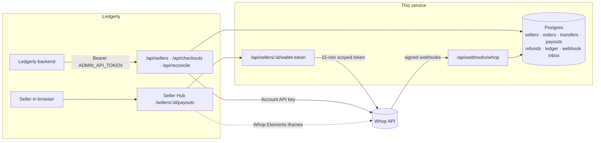
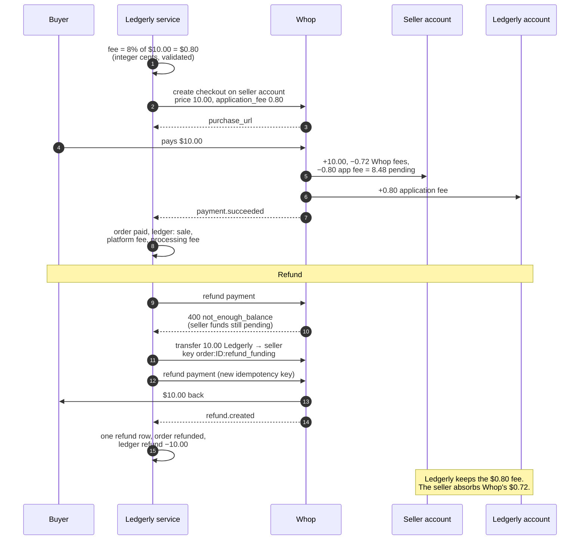
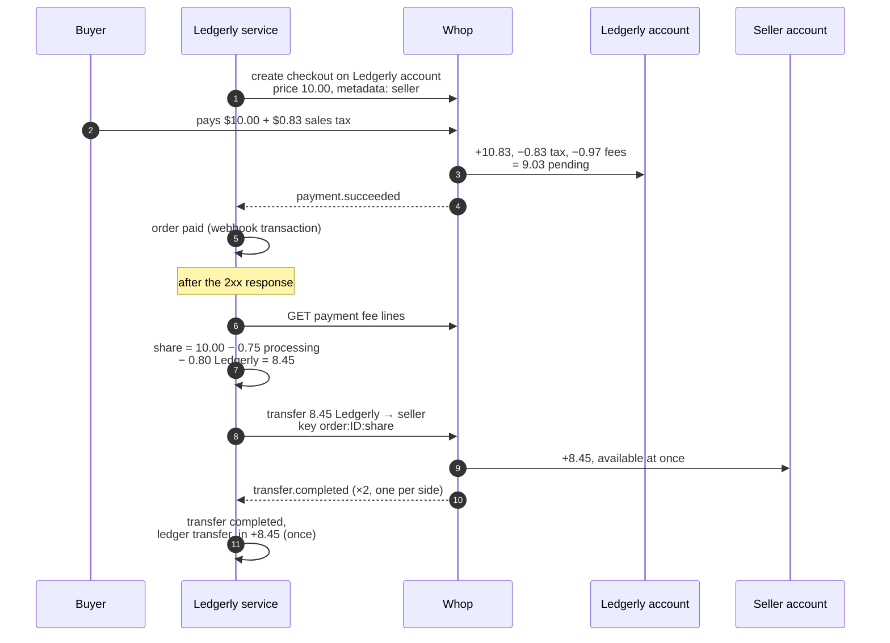

# Ledgerly on Whop

Ledgerly is a marketplace for creators' digital goods: 3,000 sellers in 40 countries. This repo moves it off its own processor and monthly wire payouts onto **Whop Platforms**:

- every seller is a Whop **connected account** under Ledgerly's platform account
- buyers pay through Whop, and Ledgerly keeps **8% of every sale**
- sellers see their balance and **withdraw on their own**, inside Ledgerly's site
- some sellers are never allowed to take payments directly; Ledgerly collects and pays them by **transfer** (enforced by this service; see [the boundary](#decisions-and-trade-offs))
- each webhook's effects are applied **once per Whop object** (payment, refund, dispute, transfer, payout) across retries, replays, near-duplicates and restarts, covered by integration tests on a real Postgres. [What that does and doesn't cover](#what-is-and-isnt-guaranteed)
- an hourly **reconciliation** checks Ledgerly's books against Whop's and catches anything Whop never sent

It runs in production at <https://ledgerly-whop.vercel.app> (Next.js on Vercel, Postgres on Supabase). Everything here was exercised with real money; the proof run and raw API responses are in [`examples/assessment/`](examples/assessment) with personal data removed.

Around the payments core it hosts an **operator console** for Ledgerly staff (`/`) and a small **demo marketplace** (`/shop` for buyers, `/sell` for sellers) that stands in for Ledgerly's own storefront, so the whole flow can be tried end to end.

**Production, not sandbox.** The assessment asked for the sandbox. Whop's sandbox doesn't support payouts or the embedded payout components yet, and when asked for platform access Whop's team said to use production. Every flow here ran in production with small real amounts: three $2–10 purchases, a $50 balance top-up, and a $10 withdrawal.

> **Ledgerly team: start with [HANDOVER.md](HANDOVER.md)** (what this is, how it plugs into Ledgerly, deploy, migrate sellers, open decisions) and keep [RUNBOOK.md](RUNBOOK.md) for on-call. This README is the technical reference.

---

## Contents

1. [Architecture](#architecture)
2. [Money flows](#money-flows)
3. [Webhooks: each effect once](#webhooks-each-effect-once)
4. [Reconciliation](#reconciliation)
5. [Seller payouts UI](#seller-payouts-ui)
6. [Operator console](#operator-console)
7. [Demo marketplace](#demo-marketplace)
8. [Sign-in](#sign-in)
9. [HTTP API](#http-api)
10. [Setup](#setup)
11. [Operating it](#operating-it)
12. [Decisions and trade-offs](#decisions-and-trade-offs)
13. [Whop behaviour to know before going live](#whop-behaviour-to-know-before-going-live)
14. [Assessment proof run](#assessment-proof-run)

---

## Architecture



| Path | What lives there |
| --- | --- |
| [`src/lib/onboarding.ts`](src/lib/onboarding.ts) | Idempotent create-or-fetch of a seller's connected account + onboarding link |
| [`src/lib/checkout.ts`](src/lib/checkout.ts) | 8% fee math, direct-charge and platform-collected checkouts, seller share + settlement |
| [`src/lib/transfers.ts`](src/lib/transfers.ts) | Keyed, replay-safe transfers to sellers |
| [`src/app/api/webhooks/whop/route.ts`](src/app/api/webhooks/whop/route.ts) | Webhook endpoint: signature check, then the processor |
| [`src/lib/webhook-processor.ts`](src/lib/webhook-processor.ts) | Inbox + handler in one transaction, deferred events, durable error record, replays |
| [`src/lib/webhook-handlers.ts`](src/lib/webhook-handlers.ts) | Per-event business effects (payments, refunds, disputes, transfers, payouts, accounts) |
| [`src/lib/webhook-setup.ts`](src/lib/webhook-setup.ts) | The webhook's subscribed events and version pin; create / sync |
| [`src/lib/reconcile.ts`](src/lib/reconcile.ts) | Two-way diff of Whop vs the local ledger |
| [`src/lib/wallet.ts`](src/lib/wallet.ts) | Short-lived, explicitly scoped tokens for the embedded payouts UI |
| [`supabase/migrations`](supabase/migrations) | Schema |
| [`cli/ledgerly.ts`](cli/ledgerly.ts) | The `pnpm ledgerly` operations CLI |
| [`src/lib/import-sellers.ts`](src/lib/import-sellers.ts) | Bulk seller migration from CSV |
| [`src/lib/ops-job.ts`](src/lib/ops-job.ts) | Hourly job: retry deferred events, refresh in-flight transfers, settle, sync verification, sync payouts, reconcile, alert |
| [`src/lib/operator.ts`](src/lib/operator.ts) | Operator console: verification mirror, seller list, reminders, payment mode, per-seller fee |
| [`src/lib/whop-oauth.ts`](src/lib/whop-oauth.ts) | Sign in with Whop (staff and seller apps), Ledgerly team check |
| [`src/lib/seller-session.ts`](src/lib/seller-session.ts) | Session cookies, `currentSeller()`, `isOperator()` |
| [`src/lib/seller-accounts.ts`](src/lib/seller-accounts.ts), [`whop-seller-signin.ts`](src/lib/whop-seller-signin.ts) | Demo marketplace: seller sign-in (Supabase Auth), opening a store |
| [`src/lib/products.ts`](src/lib/products.ts) | Demo marketplace: catalog, file uploads, buy, signed downloads |
| [`examples/assessment/`](examples/assessment) | The assessment's proof run: one script per step, plus evidence |
| [`tests/`](tests) | Unit tests (fee math, seller share on real fee data, signatures, routing, reconciliation, CSV, product rules) and [`tests/integration/`](tests/integration): routes and money handlers on a real Postgres |

---

## Money flows

Two ways money reaches a seller. Which one is used is a per-seller policy (`sellers.collection_mode`); `POST /api/checkouts` picks it, so a `platform` seller can never be given a direct checkout.

Ledgerly's fee is `PLATFORM_FEE_BPS` (8%) unless an operator set a rate for that seller (`sellers.fee_bps`, 0–50%). Both the mode and the fee are read when a checkout is created; existing orders keep theirs.

### 1. Direct charge (`collection_mode = direct`)

The buyer pays the **seller's** connected account. Whop takes Ledgerly's 8% off as an application fee and settles it to Ledgerly. The seller is the merchant: they pay Whop's processing fees and own refunds and disputes.



### 2. Platform-collected sale + transfer (`collection_mode = platform`)

The buyer pays **Ledgerly's** account; Ledgerly is the merchant of record (Whop adds and remits sales tax). As soon as the payment webhook arrives, Ledgerly transfers the seller's share. The share follows **the same fee policy as a direct charge**: gross − Whop's processing fees on that payment − 8%. Sales tax is excluded (the buyer paid it on top) and Ledgerly absorbs the tax-service fee. Amounts differ slightly between sales because Whop's fees do (the demo's direct seller netted $8.48, the platform seller $8.45).



`settlePlatformOrder` pays **what is owed minus what is confirmed**:

- It first applies any refund or dispute already waiting in the inbox for this payment (one that arrived before the payment), then checks the order and records the transfer intent in **one transaction with the order locked**, so a refund or dispute webhook can't slip in between.
- The share is computed once from Whop's fee lines and stored on the order.
- A transfer still in flight blocks another; a transfer id alone never counts as paid.
- Retries reuse the same key and send exactly the recorded intent (a different amount under the same key is refused). A request that got **no answer** stays pending and the hourly job resends it under the **same** key, which returns the original transfer if Whop created it.
- A request Whop **refused** (4xx, so no transfer exists) is retried under a new key (`…:attempt-2`).
- A transfer Whop **created and then failed** is not replaced automatically: Whop documents that a failed transfer can be retried to success under the same id, so a replacement could pay twice. The order shows as blocked; once Whop confirms the old one is final, an operator runs `pnpm ledgerly settle ORDER --replace-failed`.
- Overpayments are reported, never "fixed" by sending less.

Every transfer state change (create response, polling, `transfer.completed`/`failed`) goes through one forward-only routine, `applyTransferState`, which also books the seller's ledger once.

### Whop products

Every checkout's plan belongs to a Whop product, identified as `ledgerly-<sku>` on the account that sells it. The first checkout for a SKU on an account creates the product inline. Whop won't take the same inline product again on a connected account (`403 You are not authorized`), so later checkouts send its `product_id`. `whop_products` maps (account, `ledgerly-<sku>`) to the product id; a product made before that table existed is found once with `products.list` by `external_identifier`.

---

## Webhooks: each effect once

Whop delivers **at least once**, retries for ~3 days, doesn't guarantee order, and in practice sends near-duplicates: three identical `payout.updated` bodies with different ids for one payout, and two `transfer.completed` per transfer (one per participant). It can also skip a transition entirely (a real payout reached `completed` with no webhook). The consumer handles each case:

1. **Verify** the Standard Webhooks signature on the raw body (`unwrapWebhook` from `@whop/sdk/helpers`, `ws_…` secret used verbatim, 5-minute timestamp tolerance). Forged or stale requests get `401` and store nothing.
2. **Inbox + one transaction** ([`webhook-processor.ts`](src/lib/webhook-processor.ts)): insert the event keyed on its webhook id, lock the row, run the handler, mark it processed, all in one transaction. Concurrent deliveries of one message serialize on the lock; a processed message answers `duplicate`. If the handler throws, everything rolls back, the inbox keeps the error message (truncated) and attempt count, and the endpoint answers `500` so Whop retries.
3. **Business keys, not message ids**: every money effect is keyed on the Whop object (`payment:<id>:sale`, `refund:<id>`, `transfer:<id>`, `payout:<id>`). A near-duplicate under a new webhook id, or the second participant's `transfer.completed`, changes nothing.
4. **Forward-only or derived state**, with the guard inside the SQL: orders go `pending|failed → paid` and `payment.failed` only touches a still-`pending` order. After that, a paid order's status is **derived** from its canonical rows: any unreleased dispute → `disputed`, else booked refunds → `refunded`/`partially_refunded`, else `paid`. So a dispute won after a full refund leaves the order `refunded`. Dispute events apply in source order (an old event replayed later can't reopen a won dispute); transfers only move `pending → failed → completed`; payouts only move to a newer event time. Refunds and disputes lock the order row, so concurrent events on one order apply one at a time.
5. **Lifecycles, not single events**: refunds are booked only once Whop says `succeeded` (a pending refund waits for `refund.updated`); an open or lost dispute holds the order (not deliverable, not settled) until it's won; a transfer counts only when completed; a payout's ledger debit follows its current state (the amount while it's on its way or paid, nothing once denied, canceled, reversed or returned), posting adjustments rather than rewriting history.
6. **Deferred events**: an event about something not known yet (a refund that beats its payment) is parked, not dropped. The hourly job retries it, and closes it as unmatched after 72 hours.
7. **Version-tolerant routing**: `account_id` (payloads pinned to `2026-08-14`+), else `company_id` (older/unpinned), else the object's own account. Legacy `withdrawal.*` uses the payout handler (same `wdrl_` id).
8. Work that calls Whop (the seller transfer) runs **after** the 2xx via `after()`, so Whop never waits on it.

**Tested**: [`tests/integration/`](tests/integration) runs the real routes against Postgres with Whop stubbed: concurrent duplicate deliveries, near-duplicates, a handler crash after partial writes (all rolled back, `500`, retry succeeds), out-of-order payment and payout events, refund-before-payment, concurrent and pending refunds, disputed → refunded → won, replayed old dispute events, refund or dispute arriving before payment (seller not paid), payout reversals, denials and amount changes, payout repair (missing final state, no backwards moves, a webhook landing mid-read), double `transfer.completed`, a failed transfer later succeeding (paid once), refused vs unanswered transfer requests, a completion webhook beating the create response, completion found only by polling, a poison event in the hourly job, conflicting key reuse, concurrent checkout retries and onboarding retries. Operator actions, both Whop sign-ins, product reuse and the marketplace (buy, download, opening a store) have their own. These are route + database tests, not deployed end-to-end tests. **Proven live**: replaying real deliveries returns `duplicate` and changes nothing (`pnpm ledgerly smoke`, [evidence](examples/assessment/evidence/05-webhooks/test-replay-suspend.json)).

### What is and isn't guaranteed

- **Guaranteed** (tested): a delivered event's effects commit together or not at all, and apply once per Whop object however often it's delivered; order, refund, dispute, transfer and payout states never move backwards; this service never sends a seller's share twice on its own (an operator's `--replace-failed` is the one exception, below).
- **Not by webhooks alone**: an event Whop never delivers (or a transition it skips) is only caught by the hourly reconciliation and payout repair, or by Whop's replay.
- **Not posted to the ledger**: Whop's dispute debits and dispute fees. They show up as a balance difference in reconciliation.
- **Operator decisions**: `--replace-failed` sends a new transfer after a failed one; if Whop later completes the old one anyway, reconciliation reports the order `overpaid`.
- **Timing risk**: platform-collected sellers are paid as soon as the payment succeeds, so a refund or dispute after that is Ledgerly's to recover (see [Decisions](#decisions-and-trade-offs)).

---

## Reconciliation

```bash
pnpm ledgerly reconcile seller_us_mira   # one seller; exit code 1 if anything is off
pnpm ledgerly reconcile                  # every seller
pnpm ledgerly reconcile --fix            # first pull payout state from Whop, then diff
```

For one seller it pulls from Whop: direct-charge payments on the seller's account, platform-collected payments on Ledgerly's account tagged with that seller, transfers to the seller, payouts, and the seller's balance. It reports:

- **records**: each payment, transfer and payout diffed both ways (`missing_locally`, `missing_at_whop`, `amount_mismatch` including currency, `state_mismatch` including refunded amount and failed transfers);
- **obligations**: every paid platform-collected order has been paid its share in confirmed transfers (`unsettled`, `underpaid`, `overpaid`);
- **balance**: the seller's ledger equals their Whop balance to the cent, per currency.

`--fix` first syncs payout state from Whop, because webhooks don't cover every transition (our real payout reached `completed` with no `payout.updated` for it). Each payout is compared under a row lock and changed only if Whop's state differs, it isn't a step backwards, and nothing wrote the row since the read started (a webhook that lands meanwhile wins; the next run looks again). It then goes through the webhook handler's own `applyPayout`, so the ledger follows the same rules.

The hourly job (`/api/cron/ops`, Vercel Cron; `pnpm ledgerly ops` runs it by hand) retries deferred and failed events, settles transfers webhooks haven't (polls Whop, resends unanswered requests under the same key, and watches failed ones for two weeks), settles orders that still owe a seller something, refreshes the verification mirror for up to 100 sellers, then syncs payouts and reconciles sellers. Every stage and every item in it is isolated: one event that always fails, or Whop being down for one stage, is reported and the rest still runs. It fetches Ledgerly's payments once per run, stops starting new work at 4 minutes (reconciliation continues from the next seller on the following run; unfinished replay, transfer and settlement work is simply picked up again), always records the run in `job_runs` (latest shown on the operator console), and posts to `ALERT_WEBHOOK_URL` on any problem, including a previous run that never finished. At 3,000 sellers the full-history payment fetch should become a time window; see HANDOVER.

On its first runs it caught two real bugs in this repo's handlers (a replayed `payment.succeeded` regressing a refunded order; a replayed `refund.created` doubling `refunded_amount`) and the missing payout webhook. Snapshot at the last production check (2026-10-06): all three sellers reconcile clean, Mira 8.48 = 8.48, Batida 17.41 = 17.41 (three sales; the last a $1 end-to-end run of the deployed code), Vorlage 0.

---

## Seller payouts UI

`/sellers/:id/payouts` is Ledgerly's Seller Hub. It embeds Whop's wallet elements (balance breakdown, withdraw, activity) styled to Ledgerly's light theme.

- The page fetches a token from `/api/sellers/:id/wallet-token`, which checks the signed-in seller and mints an **account access token** for that seller only, with **explicit `scoped_actions`** and a **15-minute `expires_at`**:
  `company:balance:read`, `payout:withdrawal:read`, `payout:withdraw_funds`, `payout:destination:read`, `payout:create_destination`.
  Omitting `scoped_actions` would hand the browser every permission of Ledgerly's API key.
- The token refreshes a minute before expiry.
- After a withdrawal the `<Wallet>` is remounted (`WithdrawElement onDone`), because Whop's elements are separate iframes that otherwise keep showing the old balance.
- Ledgerly charges **+$0.50 on instant (RTP) withdrawals** for every seller (`PATCH /accounts/{platform}/fees` → `child_markups.payouts.rtp`). The fee panel reads each rail's Whop fee and Ledgerly markup live.
- **Hosted alternative**: "Open hosted payouts portal" creates a `payouts_portal` account link and redirects.

---

## Operator console

`/` is for Ledgerly staff ([sign-in](#sign-in)). Whop's dashboard (Sub accounts) already does browsing, filtering, seller details, payments and refunds, so the console only adds what Whop can't:

- **Seller list**: 25 a page, search by id, email or title, filter to sellers who still need verification. Verification is mirrored locally (`sellers.verification_status`, `outstanding_actions`) so the list never calls Whop per row: `account.updated` keeps it current, the hourly job refreshes up to 100 sellers per run (least recently synced first), and `pnpm ledgerly sellers:sync [ID]` backfills.
- **Send reminder**: asks a seller to finish verification. In-app only: recorded in `seller_reminders` and shown as a banner on the seller's `/sellers/:id` for 14 days. One per seller per 24 hours. Whop notifications aren't possible: an app can only notify accounts it's installed on, and a company API key can't install apps.
- **Payment mode**: direct or platform-collected. Applies to new purchases; logged in `seller_mode_changes`.
- **Ledgerly fee**: a percentage per seller, 0–50%; empty means the platform default (`PLATFORM_FEE_BPS`). Stored as `sellers.fee_bps`, logged in `seller_fee_changes`, applies to new purchases. For direct sellers it's the checkout's `application_fee_amount`; for platform-collected sellers it comes off their share.
- **Open in Whop**: each seller links to their connected account in Whop's dashboard.
- Cards for webhooks processed, the last hourly run and recent orders.

The same tools show on a seller's `/sellers/:id` page for staff. Each action is a form post to `/api/operator/sellers/:id/<action>`: it needs an operator session and a same-origin request, and redirects back with the outcome.

---

## Demo marketplace

Stands in for Ledgerly's storefront so the whole flow can be demoed with real money. In production Ledgerly's own site does this and calls the [HTTP API](#http-api); the payments code underneath is the same.

- **Buyers** (`/shop`, no account): **Buy** creates a Whop checkout (`createCheckout`, as `POST /api/checkouts` does) and sends them to Whop. Whop returns them to `/orders/:id`, which shows **Download** once the order is `paid`. The file comes from the private Supabase Storage bucket `deliverables` through a 60-second signed URL, re-checked on every click.
- **Sellers** (`/sell`): sign up or log in with email and password, Google or Whop. `/sell/onboard` opens a store: it creates the seller (direct mode) and their Whop connected account, then sends them to Whop's identity verification. `/sell/dashboard` has their products (files uploaded straight to Storage, up to 10 MB), verification status and a link to the Seller Hub.
- The shop lists active products with a file, from sellers that have a Whop account.

---

## Sign-in

In production, sellers sign in through Ledgerly's own site, which replaces the marketplace and demo sign-ins ([HANDOVER](HANDOVER.md)). Staff sign-in stays.

| Who | How | Code |
| --- | --- | --- |
| Staff | **Sign in with Whop** on `/`, Whop OAuth app "Ledgerly Console" | `whop-oauth.ts`, `/api/auth/whop/{start,callback}`, `/api/auth/signout` |
| Marketplace sellers | Supabase Auth: email and password, Google, or **Continue with Whop** (Whop OAuth app "Ledgerly") | `seller-accounts.ts`, `whop-seller-signin.ts`, `/auth/callback`, `/auth/whop/{start,callback}`, `/auth/signout` |
| Demo | `pnpm ledgerly login-link <seller>` or `--operator` | `seller-session.ts`, `/demo/login` |

- **Staff**: OAuth 2.1 with PKCE on the server, as a confidential client (`WHOP_OAUTH_CLIENT_SECRET` never reaches the browser). Once Whop confirms who they are, the service checks Ledgerly's Whop team (`teamMembers.list`, needs `company:authorized_user:read`) and lets in owners, admins, managers and support; anyone else is told why. Whop's tokens aren't kept (the refresh token is revoked straight away). The session is a signed cookie that lasts 8 hours. Manage staff in Whop (Settings → Team).
- **Sellers**: Supabase Auth with email confirmation on. Google is a Supabase provider. Whop can't be one: Whop requires an OIDC `nonce` that Supabase's custom providers don't send. So our server runs the Whop round trip (same code as staff, with the seller app), requires a verified Whop email, finds or creates the Supabase user with that email, and starts their Supabase session (`auth.admin.generateLink` → `verifyOtp`). `seller_users` links a Supabase user to their seller (one store each). `src/proxy.ts` refreshes the Supabase session cookie on page requests.
- **Demo links** expire in 24 hours and open an 8-hour session. Tokens are signed with their purpose: a link can only start a session and a session cookie can't be exchanged for a new one. Off unless `DEMO_LOGIN_ENABLED=true`; every console or demo session needs `SESSION_SECRET`.

`currentSeller()` is the demo seller session if there is one, else the Supabase seller. A staff session doesn't hide it: someone can be both. `isOperator()` is true only for a staff session. Seller status pages show details only to that seller or staff, and staff tools only on other people's stores; on your own store you see the seller view.

---

## HTTP API

All admin endpoints take `Authorization: Bearer $ADMIN_API_TOKEN`. Errors: `400` invalid input, `404` unknown seller, `409` conflicting retry, `502` Whop refused (its type, code and message only), `500` internal (no details).

| Method | Path | Body | Returns |
| --- | --- | --- | --- |
| `POST` | `/api/sellers` | `{ externalId, email, country, title?, collectionMode? }` | `{ accountId, created, onboardingUrl, expiresAt }`. `201` when created, `200` when it already existed. Safe to retry; a retry with a different email, country or policy is `409`. |
| `POST` | `/api/checkouts` | `{ sellerExternalId, title, sku, price, requestKey? }` | `{ orderId, checkoutId, purchaseUrl, price, fee, flow }`. Flow follows the seller's policy. USD only. Pass `requestKey` (e.g. Ledgerly's cart id) to make retries, including concurrent ones, return the same checkout; reusing it for a different seller, title, SKU or price is `409`. |
| `GET` | `/api/orders/:orderId` | | Order status; deliver the file when `deliverable` is `true`. |
| `GET` | `/api/reconcile/:externalId` | | Reconciliation report; `409` if anything is off. |
| `GET` | `/api/cron/ops` | (Vercel Cron, `Bearer $CRON_SECRET`) | The hourly operations run |
| `POST` | `/api/webhooks/whop` | Whop webhook | `{ outcome: processed \| duplicate \| ignored \| deferred }` |
| `GET` | `/api/sellers/:id/wallet-token` | (seller session) | `{ token, expiresAt }` |
| `GET` | `/api/sellers/:id/payouts-portal` | (seller session) | Redirect to Whop's hosted portal |
| `GET` | `/api/sellers/:id/onboarding-link` | (seller session) | Redirect to a fresh Whop onboarding link (the "Continue verification" / "Get a new link" button on `/sellers/:id`) |
| `POST` | `/api/operator/sellers/:id/<action>` | (operator session, same-origin form post) | Redirect back with the outcome. See [Operator console](#operator-console) |
| `POST` | `/shop/:productId/buy` | form `nonce` | Redirect to Whop's checkout (or to the order if it's already paid). A repeated nonce reuses the order |
| `GET` | `/orders/:orderId/download` | | Redirect to a 60-second signed file URL; `403` unless the order is `paid` |

```bash
curl -X POST "$APP_URL/api/sellers" -H "Authorization: Bearer $ADMIN_API_TOKEN" \
  -H 'content-type: application/json' \
  -d '{"externalId":"seller_de_vorlage","email":"vorlage@example.com","country":"DE","title":"Vorlage Studio"}'
```

---

## Setup

```bash
pnpm install
cp .env.example .env.local          # fill in, see below
supabase link --project-ref <ref>
supabase db push                    # applies supabase/migrations
pnpm dev
```

1. **Platform account**: create Ledgerly's business on Whop (dashboard or `whop accounts create`).
2. **API key**: dashboard → Developer → Create API key → Custom permissions (see scopes below). Creating keys requires 2FA; API keys cannot create API keys.
3. **Webhook**: deploy, set `APP_URL`, then `pnpm ledgerly webhook:create`. It creates one webhook on the platform account with `child_resource_events: true`, pinned to `api_version_date: 2026-09-29`, subscribed to the assessment's eight events plus `refund.updated`, `dispute.updated` and `transfer.failed` (so refunds, disputes and transfers reach a final state), and writes the signing secret to `.env.local` without printing it. `pnpm ledgerly webhook:sync` brings an existing webhook in line.
4. **Sign-in and the demo marketplace**: two Whop OAuth apps, Supabase Auth providers and a Storage bucket. Steps in [HANDOVER](HANDOVER.md#deploy-your-own-copy); variables in [`.env.example`](.env.example).
5. **Vercel**: add the same env vars (`vercel env add …`) and `vercel deploy --prod`.
6. **Check**: `pnpm ledgerly smoke` runs live checks that move no money.

### API key scopes

The key needs these permissions. Most are used on every request; a few are only for setup or optional features, marked below.

| Area | Scopes |
| --- | --- |
| Connected accounts | `company:create_child`, `company:basic:read`, `company:balance:read` (capabilities, balances) |
| Account links (onboarding, hosted portal) | `payout:account:read`, `payout:account:update`, `payout:transfer:read`, `payout:transfer:export`, `payout:withdrawal:read`, `payout:withdraw_funds`, `payout:destination:read`, `payout:create_destination`, `payout:update_destination`, `payout:delete_destination`. Whop requires the key to hold every action a link's token carries; this isn't documented (found by error messages and the token's claims). |
| Checkouts | `checkout_configuration:create`, `checkout_configuration:basic:read`, `plan:create`, `plan:basic:read`, `access_pass:create`, `access_pass:basic:read` (products are access passes; read finds a seller's existing product) |
| Payments | `payment:basic:read`, `payment:manage` (refunds), `payment:dispute:read` |
| Transfers | `payout:transfer_funds` (plus the transfer read scopes above) |
| Staff sign-in (team check) | `company:authorized_user:read` (and the OAuth app itself needs `oauth:token_exchange`) |
| Webhooks | `developer:manage_webhook`, `webhook_receive:payments`, `:refunds`, `:disputes`, `:transfers`, `:withdrawals`, `:accounts` |
| Setup / occasional | `company:update_child_fees` (withdrawal markup), `company:suspend_child` (suspensions), `payment:charge` (scripted top-ups) |
| Optional | `identity:read`, `identity:write`: only if you embed Whop's KYC element; the current pages don't |

---

## Operating it

`pnpm ledgerly help` lists every command. The ones you'll use:

| Command | What it does |
| --- | --- |
| `pnpm ledgerly import-sellers FILE.csv [--dry-run]` | Bulk-migrate sellers; safe to re-run; writes a results CSV with onboarding links |
| `pnpm ledgerly onboard --external-id … --email … --country …` | One seller |
| `pnpm ledgerly onboarding-link ID` | Fresh onboarding link (never creates a second account) |
| `pnpm ledgerly checkout --seller ID --title … --sku … --price 10` | Create a checkout from the terminal |
| `pnpm ledgerly reconcile [ID] [--fix]` | Diff Whop vs local; non-zero exit on any discrepancy |
| `pnpm ledgerly settle [ORDER_ID]` | Pay what's still owed on platform-collected orders. `--replace-failed` (one order) only after Whop confirms a failed transfer is final |
| `pnpm ledgerly transfers:refresh` | Ask Whop about pending transfers; resend unanswered requests under the same key |
| `pnpm ledgerly ops` | Run the hourly ops job now and print its summary |
| `pnpm ledgerly reprocess [EVENT_TYPE]` | Retry deferred/failed events; with a type, re-apply every stored event of it (idempotent). It can't recover an event Whop never delivered: use reconcile and Whop's replay for that |
| `pnpm ledgerly trace PAY_ID` | A payment's fee lines and both balances |
| `pnpm ledgerly webhook:create` / `webhook:sync` | Register the platform webhook (secret to `.env.local`) / update its events and pin |
| `pnpm ledgerly sellers:sync [ID]` | Refresh the console's verification mirror from Whop, for one seller or all |
| `pnpm ledgerly login-link ID \| --operator` | Demo sign-in link (24h) |
| `pnpm ledgerly smoke` | Live checks against the deployment that move no money |
| `pnpm test` · `pnpm test:integration` · `pnpm typecheck` · `pnpm lint` | Checks. `test:integration` starts a throwaway Postgres in Docker. CI runs all of them plus `pnpm build` on pushes to `main` and on pull requests |

Incident playbooks are in [RUNBOOK.md](RUNBOOK.md).

---

## Decisions and trade-offs

- **Fee math in integer cents.** `8%` of `$9.99` is `79.92¢ → 80¢`. Prices with more than 2 decimals, fees that round to zero, and fees ≥ price are rejected before Whop is called.
- **`application_fee_amount` on direct charges**, as the brief specifies. It's a legacy field the current SDK types don't include (sent through as an extra field, with the required legacy `product.external_identifier`). At scale, a **payment markup** on connected accounts (`child_markups.payments`) would let Whop take the 8% on every charge with nothing to forget per checkout.
- **Same fee policy for both flows.** A platform-collected seller bears the same kinds of fees a direct-charge seller would (Whop's processing fees and Ledgerly's 8%); Ledgerly absorbs the tax-service fee it incurs as merchant of record.
- **USD only, for now.** Checkouts accept USD. Settlement, transfers and reconciliation were exercised in USD; adding EUR or BRL needs per-currency settlement checks first.
- **"Never take payments directly" is enforced here, not by Whop.** This service never creates a direct checkout for a `platform` seller, but their Whop account still has card acceptance enabled, so another integration or the Whop dashboard could. Whop's API has no switch to disable it (capabilities are read-only); ask Whop to restrict those accounts if the guarantee must hold platform-wide.
- **Immediate transfers from float.** Platform-collected sellers are paid as soon as the payment succeeds, from Ledgerly's available balance, and then withdraw themselves. Sellers get money fast; Ledgerly carries ~1–2 days of settlement, refund and dispute risk. Holding the share until the refund window passes (escrow) is an open decision in HANDOVER.
- **Ledgerly fronts refunds** when a seller's balance is pending: transfer, then refund. The advance is a receivable from the seller to recover from future sales (not automated here).
- **Local ledger mirrors the seller's Whop balance**: sale, Ledgerly fee, Whop processing fees (from Whop's `amount_after_fees`, never recomputed), refunds, transfers in, payouts.

---

## Whop behaviour to know before going live

Found while running this in production:

1. **A "usd" transfer can move USDT.** Ledgerly's balance was funded with a USDT crypto deposit (arrives in seconds; a bank deposit takes 1–3 business days). Every `transfers.create` with `currency: "usd"` was then paid from that USDT and delivered USDT to the seller, while the transfer object still reported `usd`. Balances blend USD and USDT by value, and a refund drove a seller's USD balance negative while their USDT covered it. Fund the platform balance in the currency you intend sellers to receive.
2. **Refunds on direct charges need the seller's *available* balance**, so a new seller can't refund a sale until it settles, and never fully without covering Whop's fees. The application fee is not returned on refund.
3. **`status` hides refunds and failures**: a refunded payment stays `paid` (substatus `refunded`); a declined one is `open` (substatus `failed`).
4. **Idempotency replays failures for 24h.** Retrying with the same `Idempotency-Key` after fixing the cause returns the cached error (`Idempotent-Replayed: true`). Use a new key for a genuinely new attempt.
5. **Duplicate-ish webhooks**: identical `payout.updated` bodies with different ids; `transfer.completed` twice. Dedupe on the object id.
6. **Webhooks can miss the final state.** A real payout reached `completed` with no `payout.updated` for it. Reconcile on a schedule.
7. **Every payout starts in `in_review / risk_review`**, then `processing / awaiting_provider_acceptance` → `in_transit`. Minimum payout is **$10**.
8. **Sales tax is added on top** when Ledgerly is the merchant of record, not on direct charges to individual sellers.
9. **Transfers to unverified sellers succeed** and are immediately available; only withdrawal requires KYC.
10. **Connected accounts can take payments before KYC**; only money out is gated.
11. **Webhook payloads carry personal data** (payee legal name, buyer name, card BIN and last 4) to the platform. Treat the inbox as PII.
12. **A failed transfer can still succeed.** Whop's API reference says a `failed` transfer may be retried under the same id and later resolve to `succeeded`. Never send a replacement just because a transfer failed.
13. **A confidential OAuth app needs `oauth:token_exchange`.** Without it on the app's Permissions tab, the code exchange fails with `401 invalid_client`. The OAuth guide doesn't mention it, and `apps.create` doesn't return the client secret.
14. **Whop's OAuth requires an OIDC `nonce`.** Supabase's custom OIDC providers don't send one, so "Sign in with Whop" can't be a Supabase provider. Run the OAuth flow on your own server.
15. **An inline product can't be re-sent on a connected account.** The first checkout can create the product inline (`plan.product` with `external_identifier`). Sending the same inline product to that seller's account again fails with an opaque `403 You are not authorized`. Reference it by `product_id`.
16. **Apps can only notify accounts they're installed on, and a company API key can't install apps.** The platform can't send Whop notifications to its connected accounts.
17. **Seller countries**: Whop onboards sellers from the ISO country list minus sanctioned countries. The store form offers that list (`COUNTRY_NAMES` in `src/components/ui.tsx`); Whop's verification has the final say.

---

## Assessment proof run

The Whop Platforms FDE assessment's Part 1 was run end to end in production with these scripts. Ids, steps and evidence: [`examples/assessment/README.md`](examples/assessment/README.md).
